# Safe CBF-RRT*

This repository provides a MATLAB implementation of a safe motion-planning framework based on Rapidly-exploring Random Trees Star (RRT*) augmented with Control Barrier Function (CBF) constraints. The objective is to compute a feasible path that is both efficient and compliant with obstacle-avoidance requirements.

## Overview

The implementation combines two complementary components:

- a safety field $h(x)$, constructed from the environment geometry and obstacle configuration;
- a sampling-based planner that evaluates candidate edges against both collision constraints and CBF-based safety constraints.

This formulation allows the planner to favor trajectories that remain in regions of higher safety margin while still preserving the asymptotic exploration properties of RRT*.

## Method

The pipeline consists of the following stages:

1. Construct a safety function $h(x)$ over the workspace using a Poisson-based formulation.
2. Compute the spatial gradients $\nabla h(x)$, which are used to evaluate local safety variation.
3. Run the Safe CBF-RRT* planner, where each candidate edge is validated against:
   - obstacle occupancy constraints;
   - CBF admissibility conditions.
4. Return a feasible path, together with associated path-length and safety metrics.

## Repository Structure

- [example.m](example.m) — main script for reproducing the example experiment.
- [source/GeneratePoissonSafetyFunction.m](source/GeneratePoissonSafetyFunction.m) — generation of the safety function and its derivatives.
- [source/SafeCBFRRTStar.m](source/SafeCBFRRTStar.m) — implementation of the Safe CBF-RRT* planner.
- [paper/](paper/) — supporting manuscript material, figures, and bibliography.

## Requirements

- MATLAB (recommended) or Octave
- No external dependencies are required.

## Running the Example

1. Open MATLAB in the repository root.
2. Add the source directory to the MATLAB path:

```matlab
addpath('source');
```

3. Execute the example script:

```matlab
example
```

The script generates several figures illustrating:
- planning without CBF constraints;
- planning with CBF constraints;
- the resulting trajectories in the example environment.

All figures produced by the script are saved as SVG files in `fig/`, including the three trajectory plots and the obstacle-distance and path-length comparison plots.

### Plots generated by `example.m`

The following plots are saved when `example.m` runs. The trajectory plots show the successful paths from each planning configuration:

**RRT* without CBF safety constraints**

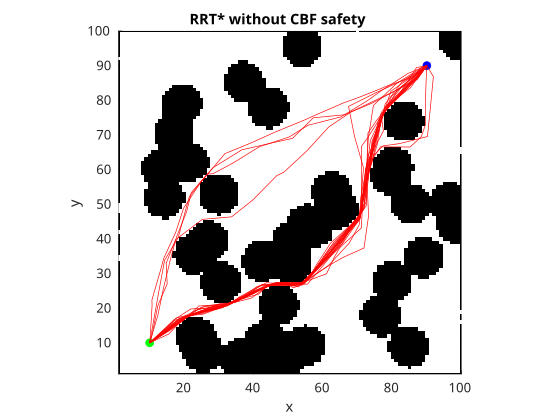

**CBF safety with time optimization** — path colors indicate segment speed.

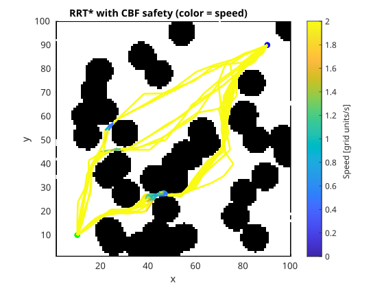

**CBF safety without time optimization** — uses the non-time edge cost.

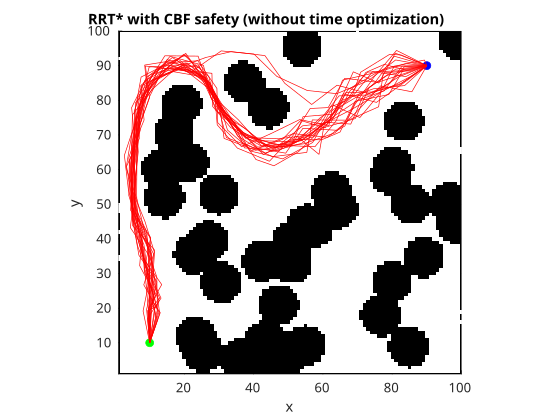

The remaining figures summarize obstacle clearance and path length over the Monte Carlo trials:

<!-- **Average obstacle distance without CBF** — mean nearest-obstacle distance along the path, plotted against path progress.

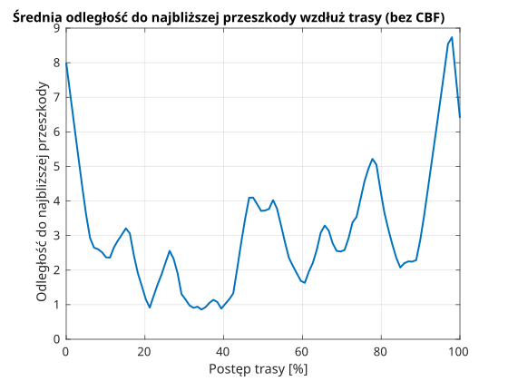 -->

**Average obstacle distance comparison** — mean nearest-obstacle distance over path progress for all three configurations.

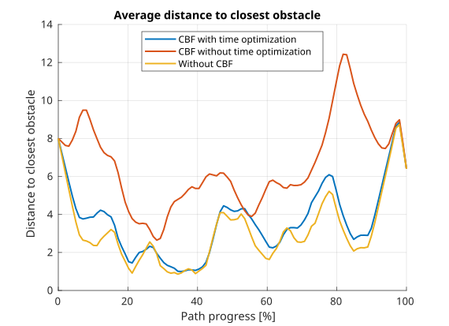

**Path length distribution** — successful path lengths for all three configurations.

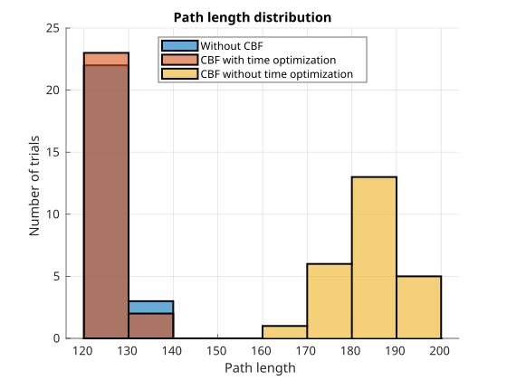

**Minimum obstacle distance comparison** — mean minimum obstacle distance with standard-deviation error bars for each configuration.

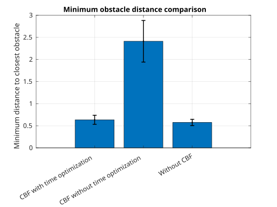

## Parameters

The example in [example.m](example.m) allows modification of several key parameters, including:

- start and goal positions;
- the number of Monte Carlo trials `N`;
- planner settings such as `maxIter`, `stepSize`, `kappa`, `v`, and `do_cbf`.

## Time Optimization

Set `params.min_time = true` to make RRT* use traversal time as its edge cost. For each candidate segment, the planner selects the greatest speed no greater than `params.v` that satisfies the CBF condition at the sampled points along that segment. In the direction of travel, the condition is

$$
v (\frac{\partial x(x)}{\partial x}\cos{\theta} + \frac{\partial x(x)}{\partial
y}\sin{\theta}) + \kappa h(x) >= 0
$$

where $\theta$ is the segment heading. If the safety gradient limits the speed, the planner reduces it to the most restrictive feasible bound; otherwise, it uses `params.v`. The segment travel time is its length divided by that speed, and these travel times are summed for the RRT* cost. Thus, this option optimizes time within the configured speed cap and sampled CBF checks; it does not imply an unconstrained or continuous-time global optimum. Set `params.min_time = false` to use the planner's non-time edge cost instead. The example compares CBF planning with time optimization enabled and disabled.

## Representative Results

The repository includes example visualizations generated from the described procedure:

<!-- 

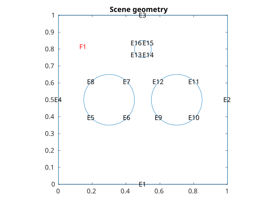 -->

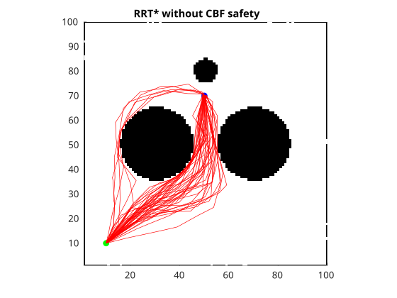

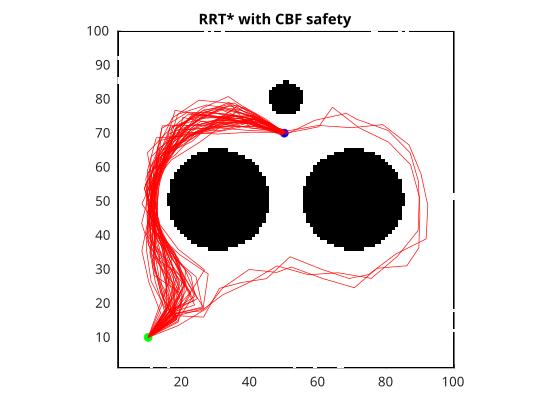


### Average distance to obstacle
Base: Average distance to closest objstacle = 3.743 +/- 0.831
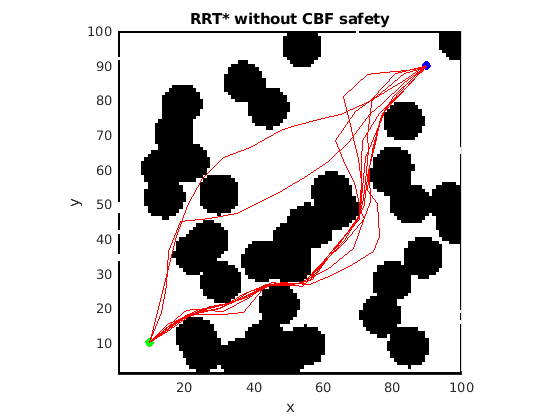
Ours: Average distance to closest objstacle = 4.658 +/- 0.326
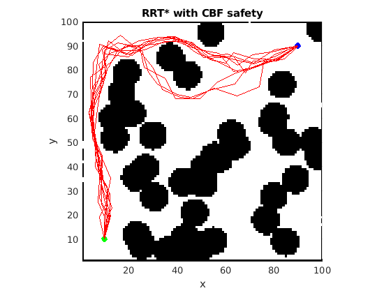

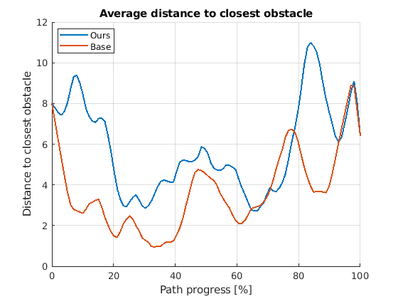

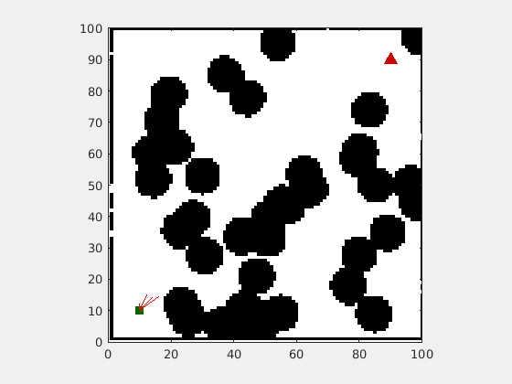
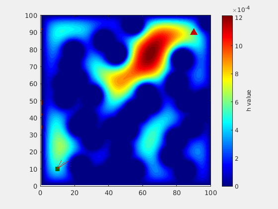

## Notes

- Setting `do_cbf = true` enables the CBF-based safety constraint.
- Setting `do_cbf = false` recovers the standard RRT* behavior without the safety filter.
- For more demanding scenarios, increasing `maxIter` or tuning `kappa` and `v` may improve feasibility and path quality.
- The time-optimized example uses grid-coordinate distances and reports speeds in grid units per second.